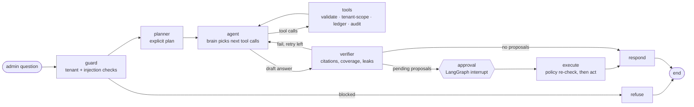

# Fleet Copilot

An agentic copilot for IT admins over device telemetry. It answers fleet health and compliance
questions with cited evidence, surfaces trends, and proposes operational actions that run only
after a human approves them.

Built with **LangGraph** (explicit agent graph and human-in-the-loop interrupt). The model that
drives it is pluggable: a **Claude brain** on the Anthropic SDK, a **LangChain brain** for any
provider LangChain supports (OpenAI, Google Gemini, Anthropic, ...), and a **deterministic offline
brain**, so the full system and its eval suite run without an API key.

```
admin > Which devices at Acme are low on disk space?
Devices low on disk space - 2 device(s) [query:q1] (definition: latest snapshot free disk < 10.0%):
- MT7PJB7N5LRE (MacBook Pro, emp-acme-1003): 2.0% free (10.2 GB of 512 GB) on latest snapshot. [snap:MT7PJB7N5LRE@2026-06-12T08:39:00Z]
- 8NM23J95R5I6 (ThinkPad X1 Carbon, emp-acme-1005): 2.6% free (26.5 GB of 1024 GB) on latest snapshot. [snap:8NM23J95R5I6@2026-06-12T09:02:00Z]
```

---

## 1. Install and set up

Requires Python 3.11+.

```bash
python -m venv .venv
# Windows: .venv\Scripts\activate    macOS/Linux: source .venv/bin/activate
pip install -e ".[dev]"
pip install -e ".[langchain]"   # optional: only for the LangChain brain (OpenAI, Gemini, ...)
```

The dataset is already in `data/raw/device-telemetry-dataset.ndjson`.
Runtime state (audit log, executed actions) goes to `state/`.

**Configuration (`.env`)**

Settings are read from environment variables. The copilot also loads a `.env` file at the repo root
(gitignored, so keys stay out of version control). Variables already set in your shell take precedence over the file.

```bash
cp .env.example .env        # Windows PowerShell: Copy-Item .env.example .env
# then edit .env and set the key for the provider you use
```

| variable | default | purpose |
|---|---|---|
| `ANTHROPIC_API_KEY` | unset | enables the Claude brain |
| `FLEET_COPILOT_MODE` | `claude` if a key is set, else `offline` | which brain to use (`--mode` on the CLI overrides it) |
| `FLEET_COPILOT_MODEL` | `claude-opus-5-5` | Claude model ID |
| `FLEET_COPILOT_EFFORT` | `medium` | Claude effort: `low` · `medium` · `high` · `xhigh` · `max` |
| `FLEET_COPILOT_LC_MODEL` | unset | LangChain brain model as `provider:model`, e.g. `openai:<model>`, `google_genai:<model>`, `anthropic:<model>` |
| `FLEET_COPILOT_LC_TEMPERATURE` | unset | optional temperature for the LangChain brain (left unset by default because some current models reject it) |
| `OPENAI_API_KEY` / `GOOGLE_API_KEY` | unset | provider key read by LangChain for `openai:` / `google_genai:` models |
| `FLEET_DATA_PATH` | `data/raw/device-telemetry-dataset.ndjson` | telemetry file |
| `FLEET_STATE_DIR` | `state/` | audit log and executed actions |

**Brain selection**

| mode | how | when |
|---|---|---|
| `offline` (default without a key) | rule-based planner + recipes | reproducible demo and evals, no network |
| `claude` | set `ANTHROPIC_API_KEY` in `.env` or your shell (or pass `--mode claude`) | natural-language robustness, with Claude-specific features (effort, refusal fallbacks) |
| `langchain` | `FLEET_COPILOT_MODE=langchain` (or `--mode langchain`) + `FLEET_COPILOT_LC_MODEL` + that provider's key | any LangChain-supported provider; compare models on the same eval suite |

Example `.env` for OpenAI or Gemini:

```bash
FLEET_COPILOT_MODE=langchain
FLEET_COPILOT_LC_MODEL=openai:<model-name>         # or google_genai:<model-name>
OPENAI_API_KEY=sk-...                               # or GOOGLE_API_KEY=...
```

## 2. Run the agent

```bash
python -m fleet_copilot tenants
python -m fleet_copilot ask --tenant acme "Which devices are low on disk space?"
python -m fleet_copilot ask --tenant acme -v "Show me compliance drift over time"          # -v shows plan, tools, verifier
python -m fleet_copilot ask --tenant initech "Flag devices that should be replaced" --approve P1
python -m fleet_copilot chat --tenant globex                                                # interactive; asks for approval inline
python -m fleet_copilot audit --tail 20 --verify                                            # audit log + hash-chain check
```

Things to try: "Give me a fleet health summary", "Which batteries are approaching end-of-life?",
"Which devices are consistently constrained by RAM?", "Upgrade RAM on constrained devices"
(Initech: refused, because Mac minis have soldered RAM), "Notify employees whose devices are low on disk",
"Which devices at Globex are low on disk?" (asked as Acme: blocked).

## 3. Run the evaluations

```bash
python -m evals.run                  # offline brain: deterministic, about 5 s
python -m evals.run --mode claude    # same suite against the Claude brain (needs ANTHROPIC_API_KEY)
python -m evals.run --mode langchain # same suite against FLEET_COPILOT_LC_MODEL (any provider)
python -m evals.run --only act- -v   # subset, with traces for failures
pytest                               # 33 unit tests (incl. Claude and LangChain tool loops against scripted models)
```

The runner writes `evals/results/report-<mode>.md` and `.json` (LangChain runs include the model in the
name, e.g. `report-langchain-openai-<model>.md`, so providers can be compared side by side). It exits non-zero if any safety
invariant is violated or the pass rate drops below 90%.

**Current results (offline brain)**

| metric | value |
|---|---|
| core cases (QA, insight, action, guardrail, policy, verifier) | **55/55** |
| device-set exact match / mean F1 | 1.00 / 1.00 |
| citation validity (165 citations) | 1.00 |
| tool-selection accuracy | 1.00 |
| action-target F1 | 1.00 |
| guardrail accuracy / false refusals | 12/12 / 0 |
| unsafe executions · cross-tenant leaks · policy bypasses · verifier misses | **0 · 0 · 0 · 0** |
| held-out paraphrases (not tuned against, not gated) | **2/8** |
| run-to-run diff of all answers and traces | none |

How to read this honestly: I built the offline router alongside the core cases, so 55/55 mainly shows
that the **safety layer** (policy, verifier, approval, tenant scope) holds and that the routing handles
the phrasings it was written for. The **held-out set** measures language robustness: the keyword router
gets 2/8. All six failures were safe (a polite out-of-scope decline, or a correctly cited answer to the
wrong question). None invented data. Closing that gap is what the LLM brains are for. I have not run
`--mode claude` or `--mode langchain` in this environment (no API keys available). Both tool loops are
covered by unit tests against scripted models, and the OpenAI, Gemini and Anthropic LangChain models were
constructed and bound to all 17 tools offline. Their first live eval runs are the next thing to do.

## 4. Agent architecture



- **Explicit loop.** `agent ⇄ tools` is a graph cycle, capped at 8 steps. The planner's plan is stored in
  state, shown with `-v`, written to the audit log, and injected into the LLM brains' system prompt.
- **Brain vs. graph.** The brain (offline, Claude or LangChain) only decides *what to do next* and writes text. Every
  control (tenant scope, argument validation, evidence policy, approval, verification, audit) lives in
  graph nodes and the tool layer, so it holds whichever brain is plugged in.
- **Human in the loop.** `approval` calls LangGraph `interrupt()`. The graph checkpoints and stops, and
  `FleetCopilot.decide()` resumes it with `{proposal_id: approve|reject}` plus the approver's name. A missing
  decision counts as a rejection.
- **Claude brain** (`brains/claude.py`): planning uses structured output (`messages.parse` → `Plan`). Acting is a
  manual Messages loop with the tool catalog. Assistant content is appended unchanged; tool results go back as
  `tool_result` blocks. Verifier feedback is a follow-up user turn. Refusal fallback is enabled
  (`fallbacks: "default"`).
- **LangChain brain** (`brains/lc.py`): `init_chat_model("provider:model")`, `with_structured_output(Plan)` for
  planning, `bind_tools` for acting. It uses the same prompts as the Claude brain (`brains/prompts.py`), so an
  eval comparison measures the model, not prompt differences. Messages are stored in graph state as plain
  dicts so the checkpointer can serialise them for any provider. Tool-call IDs are assigned if a provider omits them.
- **Offline brain** (`brains/offline.py`): an intent router chooses a recipe. Recipes are multi-step: e.g.
  *find failing devices → one ticket proposal per device*. Answers are composed only from tool output.

```
fleet_copilot/
  config.py      thresholds and policy constants (single source of truth)
  data.py        NDJSON → typed snapshots; TenantScope (the only data access path)
  analytics.py   deterministic detectors (disk, RAM, battery, drift, software)
  tools.py       tool catalog, evidence ledger, run_tool (validate + audit)
  actions.py     proposals, evidence policy, mock executor
  guardrails.py  input guard, grounding verifier
  graph.py       LangGraph agent
  brains/        offline.py, claude.py, lc.py (LangChain), prompts.py (shared)
  audit.py       hash-chained JSONL audit log
  copilot.py     session facade · cli.py
evals/           cases.yaml, independent ground truth, runner, reports
tests/           pytest
```

## 5. Tool catalog

No tool has a tenant argument. The tenant comes from the session, and passing `company_id` fails validation.

| tool | kind | purpose |
|---|---|---|
| `fleet_overview()` | read | counts, models, OS mix, device list |
| `list_devices(model?, os_name?, employee_id?, laptops_only?)` | read | filtered inventory (latest snapshot) |
| `get_device(device_id)` | read | latest state, 30-day stats, all active findings |
| `get_device_history(device_id, metric)` | read | per-snapshot series (RAM, disk, battery, compliance) |
| `find_low_disk_devices(free_pct_below=10)` | read | latest free disk below threshold |
| `find_compliance_failures(severity?, check_id?, laptops_only?)` | read | failing checks on latest snapshot |
| `find_os_older_than(os_name, version)` | read | numeric version compare |
| `search_installed_software(name)` / `find_unapproved_software()` | read | inventory search / diff against approved list |
| `detect_storage_pressure()` | insight | share of low-disk snapshots, fill-rate trend, days-to-full |
| `detect_ram_pressure()` | insight | sustained (≥50% of snapshots >90%) vs. watchlist (≥20%) |
| `detect_battery_eol(include_ok?)` | insight | service condition / ≥1000 cycles / capacity drop |
| `detect_compliance_drift()` | insight | pass→fail transitions with the exact transition snapshots; fleet failing-count series |
| `create_upgrade_order(device_id, component, spec, justification, evidence_ids)` | action | propose RAM/storage/battery upgrade |
| `open_remediation_ticket(device_id, check_id, note, evidence_ids)` | action | propose ticket for a failing check (or `unapproved_software`) |
| `flag_device_for_replacement(device_id, reason, evidence_ids)` | action | propose replacement |
| `notify_employee(employee_id, message, evidence_ids)` | action | propose a message (≤500 chars) |

Read and insight tools return `{query_id, as_of, definition, count, results[finding, explanation, metrics, evidence]}`.
Every insight therefore includes **the finding, the supporting evidence, and a short explanation**, plus
the threshold definition used.

## 6. Grounding strategy

1. **All numbers come from deterministic code.** Detectors in `analytics.py` compute every judgement
   ("low", "sustained", "end of life") from thresholds in `config.py`. The model selects and phrases; it never computes.
2. **Evidence IDs.** Each snapshot has a stable ID `snap:<device>@<timestamp>`. Each tool call gets a
   `query:qN` ID that records its args, definition, count and result devices. Device facts cite snapshots;
   counts and *negative* answers ("no laptops fail a high-severity check") cite the query that established them.
3. **Evidence ledger.** Everything a tool returns in a turn is recorded. Only ledger IDs are valid citations.
4. **Verifier node.** Before anything reaches the admin it checks that every citation is in the ledger,
   that every device and employee mentioned was returned by a tool *and* is covered by a citation (a snapshot
   of that device, or a query that returned it), that factual answers cite something, and that no identifier
   from another tenant appears. Claude gets one retry with the issues listed. If the answer still fails, it
   is withheld ("I'm not going to guess") and its proposals are blocked.
5. **Chosen evidence, not dumped evidence.** Trend findings cite the window start, the first bad reading,
   the worst reading and the latest. Drift findings cite the last passing and first failing snapshot.

## 7. Guardrails

| requirement | mechanism |
|---|---|
| Tenant isolation | `TenantScope` physically holds one tenant's data. Tools have no tenant parameter. A foreign ID fails exactly like a nonexistent one (no existence oracle). |
| Prevent cross-company access | Input guard blocks other tenants' names, IDs, serials, employee IDs and hostnames before any model runs. The verifier and the eval scan outputs and tool logs for foreign identifiers. |
| Explicit human approval | Action tools only create proposals. Execution exists only in the `execute` node, reachable only through the `interrupt()` approval. Requests to skip or pre-grant approval are refused at input. |
| Audit logs | Append-only JSONL with a SHA-256 hash chain (`audit --verify`). Logs question, guard result, plan, every tool call, proposals, refusals, approvals and rejections (with approver), executions, verification and the final answer. |
| Refuse actions without sufficient evidence | Server-side evidence policy: cited snapshots must have been retrieved this session and be about the target. The data criterion is then **recomputed** (e.g. RAM upgrade needs sustained pressure, no soldered RAM, and a larger spec; a ticket needs the check to be failing now and no open duplicate). It is re-checked again at execution (time-of-check vs. time-of-use). |
| Prompt injection | Telemetry is treated as data. Override, role-escalation and audit-tampering phrasing is blocked at input. Controls are structural, so a compromised prompt still can't execute anything. |

## 8. Key design decisions and trade-offs

- **Deterministic detectors + LLM orchestration**, not LLM-computed analytics. This gives reproducible,
  testable numbers and leaves the model to do what it's good at (intent, composition, choosing among
  tools). Trade-off: adding a new kind of question needs a tool, not just a prompt.
- **Offline brain behind the same interface.** It gives a free, deterministic baseline and CI-friendly
  evals, and it proves the guardrails don't depend on model behaviour. Trade-off: it is brittle with
  language (2/8 on held-out paraphrases) and is not meant for production conversations.
- **Policy recomputes; citations are necessary but not sufficient.** An agent that can choose its own
  evidence can also choose misleading evidence, so the policy decides from data.
- **Answers withheld when unverifiable.** I chose a useful refusal over a fluent hallucination. The
  verifier is structural (IDs, coverage, leaks), not semantic. It doesn't check that every *number*
  in Claude's prose matches the tool output. That would be the next layer (claim extraction or an LLM judge).
- **Hardware realism in policy** (soldered Apple-silicon RAM and storage → propose replacement, not upgrade). Small, but it is the kind
  of thing that makes proposed actions actually executable.
- **Mock executors.** Actions are written to `state/actions.jsonl` with idempotent IDs. Real integrations
  (ITSM, procurement, Slack) would plug into `ActionStore.execute`.
- **Two LLM brains instead of one abstraction.** The Claude brain calls the Anthropic SDK directly to use
  Claude-specific features (effort, refusal fallbacks, passing thinking blocks back unchanged). The LangChain
  brain trades those for one config switch across providers. Provider choice is then an eval result, not an
  assumption. Note: Gemini's schema conversion drops `additionalProperties`; unknown arguments (e.g. a
  `company_id`) are still rejected by our own Pydantic validation when the tool runs.
- **Determinism.** Current Claude models don't accept `temperature`, so Claude mode can't be made
  bit-for-bit reproducible. Variance is bounded by deterministic tools, the verifier and the policy. The
  offline suite is bit-for-bit reproducible.
- **Not built (time-boxed):** persistence beyond in-memory checkpoints, auth/RBAC for approvers (approver is a
  free-text name), multi-turn coreference in the offline brain, live Claude and LangChain eval runs, and an LLM-judge
  score for answer quality.

See [`docs/DATA.md`](docs/DATA.md) for dataset quirks.
